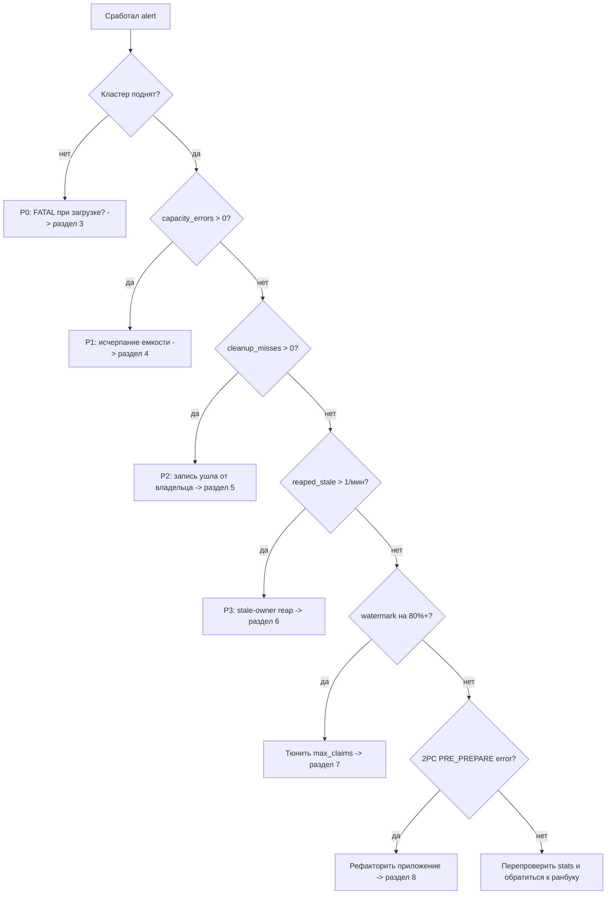
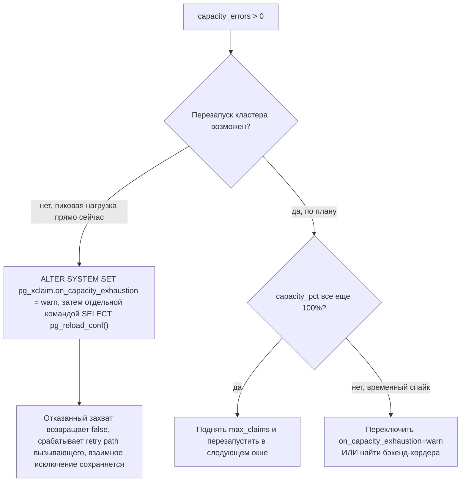

# pg_xclaim - дерево решений на инциденте

> **English version:** [`incident-decision-tree_en.md`](incident-decision-tree_en.md).

> Соглашение: каждая команда подразумевает `set -euo pipefail`, если
> используется в скриптах.

---

## Оглавление

1. [Матрица серьезности](#1-матрица-серьезности)
2. [Дерево решений (обзор)](#2-дерево-решений-обзор)
3. [P0 - кластер не запускается (FATAL при загрузке pg_xclaim)](#3-p0---кластер-не-запускается-fatal-при-загрузке-pg_xclaim)
4. [P1 - исчерпание емкости (`capacity_errors > 0`)](#4-p1---исчерпание-емкости-capacity_errors--0)
5. [P2 - очистка не нашла свою запись (`cleanup_misses > 0`)](#5-p2---очистка-не-нашла-свою-запись-cleanup_misses--0)
6. [P3 - рост частоты `reaped_stale`](#6-p3---рост-частоты-reaped_stale)
7. [Watermark на 80/90/95%](#7-watermark-на-809095)
7a. [Лог `crossed 75% of expected_claims_per_backend`](#7a-лог-строка-crossed-75-of-expected_claims_per_backend)
8. [2PC `PRE_PREPARE` reject](#8-2pc-pre_prepare-reject)
9. [Восстановление (после инцидента)](#9-восстановление-после-инцидента)

---

## 1. Матрица серьезности

| Severity | Триггер | Первое действие |
|----------|---------|-----------------|
| P0 | FATAL при загрузке pg_xclaim после деплоя -> кластер лежит | Откатить preload на затронутом узле и перезапустить. |
| P1 | `capacity_errors` растет (любой прирост) | Переключить `on_capacity_exhaustion` в `warn`, затем поднять `max_claims` в следующем окне планового обслуживания. |
| P2 | `cleanup_misses` растет (любой прирост) | Дефект pg_xclaim: собрать данные и завести issue, `enabled=off` не включать. |
| P3 | `reaped_stale` растет быстрее 1/мин | Проверить лог на ошибки при завершении транзакций и выходе бэкендов, `cleanup_misses`. |

---

## 2. Дерево решений (обзор)



---

## 3. P0 - кластер не запускается (FATAL при загрузке pg_xclaim)

### Симптом

Кластер не стартует. `pg_ctl start` возвращает ненулевой код. Лог
сервера содержит одно из:

```
FATAL:  could not load library "/usr/lib/postgresql/16/lib/pg_xclaim.so": /usr/lib/postgresql/16/lib/pg_xclaim.so: undefined symbol: MyProcNumber
FATAL:  incompatible library "/usr/lib/postgresql/17/lib/pg_xclaim.so": version mismatch
DETAIL:  Server is version 17, library is version 16.
FATAL:  pg_xclaim.expected_claims_per_backend (N) must be <= pg_xclaim.max_claims (M)
```

Первые два варианта значат, что `pg_xclaim.so` собран под другую
мажорную версию PostgreSQL, и сервер отказывается его загружать. Какое
из двух сообщений появится, зависит от того, каких символов сервера
библиотеке не хватает: сборка под PG 17+ на PG 16 падает уже на
`MyProcNumber`. Для последнего варианта (нарушен GUC-инвариант) восстановление -
понизить `pg_xclaim.expected_claims_per_backend` <=
`pg_xclaim.max_claims` и стартовать заново (см. `docs/runbook.md`
§10.6).

> **Замечание: hot-standby - это НЕ проблема.** Hot-standby (или primary,
> еще проигрывающий WAL) preload'ит pg_xclaim чисто. SQL-вызовы
> (`xclaim.try`, `xclaim.try_many`, и пр.) возвращают
> `ERRCODE_FEATURE_NOT_SUPPORTED` с сообщением
> `pg_xclaim does not support hot-standby/recovery mode`, пока узел в
> recovery - проверка срабатывает в момент вызова, а не на preload.
> Промоушн до primary заставляет вызовы успешно отрабатывать без
> restart'а или правки конфига, как только `pg_is_in_recovery() = false`.
>
> Поэтому `pg_xclaim` остается в `shared_preload_libraries` на
> репликах: реплика без него после промоушна не выдает claim'ы до
> правки конфига и рестарта.

### Расследование

1. Проверить `postgresql.conf` - действительно ли `pg_xclaim` есть в
   `shared_preload_libraries`?
2. Проверить мажорную версию запущенного PG-бинарника:
   `pg_config --version`.
3. Это узел hot-standby, который только что был промоутнут?
   `select pg_is_in_recovery();` (если можете подключиться через
   временный fallback-конфиг).
4. `ls -la /path/to/pg_xclaim.so` - существует ли `.so`? Размер
   правдоподобен (несколько сотен KB)?

### Что делать сейчас

1. Отредактировать `postgresql.conf` на затронутом узле:
   ```conf
   # shared_preload_libraries = 'citus,timescaledb,pg_xclaim'   <-- закомментировать
   shared_preload_libraries = 'citus,timescaledb'
   ```
2. Перезапустить:
   ```bash
   set -euo pipefail
   pg_ctl restart -D "$PGDATA" -m fast
   ```
3. Убедиться, что кластер поднялся: `psql -c "SELECT 1"`.

### Действия после инцидента

- Восстановите чистое состояние: пересоберите и переустановите
  предыдущий проверенный `pg_xclaim.so`. Если такого
  билда у вас нет - пока удалите бинарь полностью, до исправленного
  билда. Перезапустите кластер.

---

## 4. P1 - исчерпание емкости (`capacity_errors > 0`)

### Симптом

Запросы приложения падают с:

```
ERROR:  pg_xclaim: max_claims (4194304) exhausted
HINT:   Increase pg_xclaim.max_claims and restart, or set
        pg_xclaim.on_capacity_exhaustion to warn.
SQLSTATE: 53400
```

`xclaim.stats().capacity_errors` инкрементируется в мониторинге
(счетчик растет прямо сейчас).

### Расследование

```sql
SELECT * FROM xclaim.stats();
```

Смотрите на:
- `capacity_pct` близко к 100
- `capacity_used` близко к `capacity_max`
- `peak_per_backend` - один бэкенд держит большую часть емкости?

```sql
-- Разбивка по базам / по бэкендам
SELECT database_oid, owner_pid, count(*)
FROM xclaim.debug_snapshot()
GROUP BY 1, 2
ORDER BY 3 DESC
LIMIT 20;
```

`xclaim.debug_snapshot()` удерживает shared-lock'и всех партиций и
доступен только при `pg_xclaim.num_partitions <= 192`. При большем
числе партиций используйте `xclaim.stats()` и server log.

### Что делать - ветви решения



### Конкретные команды

**Вариант A - soft kill (без перезапуска, только при остановленном клиентском трафике):**
```sql
ALTER SYSTEM SET pg_xclaim.enabled = off;
SELECT pg_reload_conf();
```
Выключатель снимает взаимное исключение для всех ключей, поэтому при
живом трафике используйте вариант B (см. `docs/runbook.md` §4).

**Вариант B - обрабатывать исчерпание как конфликт (без перезапуска):**
```sql
ALTER SYSTEM SET pg_xclaim.on_capacity_exhaustion = warn;
SELECT pg_reload_conf();
-- Захват возвращает false на исчерпании (срабатывает retry path
-- вызывающего). xclaim.try пишет WARNING на каждый отказанный вызов.
-- xclaim.try_many пишет WARNING на первый отказанный слот и, если
-- отказанных слотов несколько, еще одно итоговое WARNING с числом
-- остальных в конце вызова. Отслеживать capacity_warnings в stats:
-- счетчик учитывает каждый отказ.
```

**Вариант C - поднять емкость (в следующем окне планового обслуживания):**
```conf
# postgresql.conf
pg_xclaim.max_claims = 8388608   # 8M (было 4M), ~582MB shmem
```
Затем `pg_ctl restart -D "$PGDATA" -m fast`.

### Действия после инцидента

- Пересмотреть `expected_claims_per_backend`, если один бэкенд
  устойчиво держал > 100k claim'ов.

---

## 5. P2 - очистка не нашла свою запись (`cleanup_misses > 0`)

### Симптом

`xclaim.stats().cleanup_misses` растет прямо сейчас (счетчик
инкрементируется). Счетчик растет, когда бэкенд при очистке не находит
свою запись в shared memory или находит ее с другим владельцем,
например после того, как ее забрал stale-owner reaper.

### Расследование

1. Сохраните `SELECT * FROM xclaim.stats();`, повторите через минуту и
   сравните `cleanup_misses`.
2. Сохраните `xclaim.debug_snapshot()` (роль `pg_monitor`) и
   `pg_stat_activity` на тот же момент.
3. Выгрузите лог сервера за время прироста: ERROR, FATAL, PANIC,
   сообщения других расширений.

### Что делать

Счетчик означает, что запись ушла от живого владельца раньше, чем он
ее снял: stale-owner reaper забрал запись живого бэкенда или shared
memory повреждена. Штатная работа этого не дает. По таким ключам могло
нарушиться взаимное исключение: два бэкенда могли одновременно считать
ключ своим.

1. Считайте это дефектом pg_xclaim: заведите issue с данными из
   расследования.
2. Проверьте данные приложения по ключам, которые обрабатывались в это
   время: возможна двойная обработка.
3. Не включайте `pg_xclaim.enabled = off`. При выключенном расширении
   `xclaim.try` возвращает true без захвата, и взаимное исключение
   пропадает для всех ключей, а не только для затронутых.
4. `xclaim.session_reset()`, `pg_terminate_backend()` и ротация пула
   не помогают: запись уже ушла от владельца.
5. Если счетчик продолжает расти, перезапустите сервер в плановое
   окно. Перезапуск создает shared memory заново.

---

## 6. P3 - рост частоты `reaped_stale`

### Симптом

`xclaim.stats().reaped_stale` растет быстрее одного инкремента в
минуту, и так не разово, а устойчиво.

### Расследование

```sql
SELECT * FROM xclaim.stats();
```

Параллельно смотрите server log вокруг времени прироста: ERROR,
FATAL и PANIC при завершении транзакций и выходе бэкендов, в том
числе от колбэков других расширений. Проверьте и `cleanup_misses`.

### Что делать

Сам по себе lazy-reaper, который подбирает устаревшие записи на
очередном конфликте, - это штатное самовосстановление. Чинить его не
нужно.

Что значит этот алерт. У каждой записи в shared memory есть "паспорт
владельца": слот бэкенда (`procno`), его pid, transaction id на момент
захвата (`lxid`) и `token` (per-backend счетчик-поколение). Reaper
считает запись устаревшей, когда в слоте уже нет этого pid или бэкенд
в слоте опубликовал другой token: владелец завершился или сменил
token, а запись в shared memory осталась.

Штатная работа таких записей не оставляет. Claims снимаются в конце
транзакции и при выходе бэкенда, `session_reset()` снимает их до смены
токена, а hard kill бэкенда (`SIGKILL`, segfault, OOM kill) PostgreSQL
обрабатывает как child crash с полным пересозданием shared memory
(`REL_18_STABLE:postmaster.c:2768-2792,3180-3202`). Поэтому алерт
означает, что какой-то путь очистки не завершился.

Действовать надо не на самом reaper'е, а уровнем выше:

| Причина | Решение |
|---------|---------|
| В логе ERROR, FATAL или PANIC при завершении транзакций или выходе бэкендов | Сохранить эти строки и `xclaim.stats()`, завести issue. |
| Одновременно растет `cleanup_misses` | См. P2 (раздел 5). |
| Вызовы `xclaim.debug_inject_stale()` | Тестовая функция, создает такие записи намеренно. Убрать из нетестовых окружений. |
| Ничего из перечисленного | Сохранить `xclaim.stats()`, `xclaim.debug_snapshot()` и лог, завести issue. |

### Действия после инцидента

- Если `reaped_stale` продолжает расти, заведите issue с собранными
  данными: штатная работа таких записей не оставляет.

---

## 7. Watermark на 80/90/95%

### Симптом (лог сервера)

```
LOG:  pg_xclaim: capacity watermark crossed -- 81% (3404288 / 4194304 claims)
```

Эмитится, когда `capacity_pct` впервые пересекает один из {80, 90, 95}.
Пороги 80% и 90% пишутся на уровне `LOG`, порог 95% эскалируется до
`WARNING`. Нижний порог контролируется GUC `pg_xclaim.capacity_warn_pct`
(default 80). Жестко заданные пороги строго ниже настроенного
`capacity_warn_pct` не эмитятся вовсе. Процент в строке целочисленный.
Тот же порог бэкенд повторяет не чаще раза в 60 секунд, а переход на
более высокий порог пишет сразу. Если бэкенд видит заполнение ниже
нижнего порога, отсчет начинается заново, и следующее пересечение
пишется сразу.

### Действие

| Порог | Severity | Действие |
|-------|----------|----------|
| 80% | warn | Запланировать поднятие `max_claims` в следующем окне планового обслуживания. |
| 90% | page | Поднять дежурного и рассмотреть переключение в режим `warn` (исчерпание = конфликт). |
| 95% | page | Найти транзакции, которые держат claim'ы (`xclaim.debug_snapshot()` по `owner_pid`, `pg_stat_activity`). Если на 90% не переключились, перейти в режим `on_capacity_exhaustion = warn` (исчерпание = конфликт). Запланировать поднятие `max_claims` с перезапуском. `pg_xclaim.enabled = off` при живом трафике не включать (§4). |

```sql
-- Посмотреть, кто заполняет емкость:
SELECT database_oid, count(*) AS claims_held
FROM xclaim.debug_snapshot()
GROUP BY 1
ORDER BY 2 DESC;
```

`xclaim.debug_snapshot()` требует `pg_xclaim.num_partitions <= 192`.

---

## 7a. Лог-строка "crossed 75% of expected_claims_per_backend"

### Симптом (лог сервера)

```
LOG:  pg_xclaim: per-backend live claims (12345) crossed 75% of
      pg_xclaim.expected_claims_per_backend (16384) -- simplehash
      will rehash on further growth
HINT:  Raise pg_xclaim.expected_claims_per_backend to your observed
       peak and restart the cluster.
```

### Что это значит

Один из бэкендов впервые в этой сессии накопил 75% от
`expected_claims_per_backend`. Это ранний предупредительный сигнал:
рост по порогу заполнения происходит, когда заполнение массива бакетов
`simplehash` достигает 0.9 (fillfactor), и 75% дает запас, чтобы
поднять GUC до того, как rehash случится на горячем пути захвата.
Раньше порога набор растет по длинной пробе, а `xclaim.try_many` пишет
эту строку после своего цикла, так что рост может прийти и до нее
(`docs/runbook.md` §3).

Это не ошибка и не причина для page'а. Расширение продолжает
работать корректно, просто платит rehash-латентность на следующих
acquire'ах. Сообщение эмитится один раз на сессию (повторно - после
`xclaim.session_reset()`, если бэкенд снова дойдет до порога).

### Что делать

1. Найти фактический peak: `SELECT peak_per_backend FROM xclaim.stats();`
2. Поднять GUC до peak с запасом x1.2-x1.5:
   ```conf
   pg_xclaim.expected_claims_per_backend = 32768   # пример: peak ~22k
   ```
3. Перезапустить кластер (PGC_POSTMASTER).

---

## 8. 2PC `PRE_PREPARE` reject

### Симптом

```
ERROR:  pg_xclaim: PREPARE TRANSACTION is not allowed while pg_xclaim claims are held
HINT:   Release pg_xclaim claims (or COMMIT/ROLLBACK the transaction) before preparing.
SQLSTATE: 0A000  -- feature_not_supported
```

### Причина

pg_xclaim явно отказывает в передаче 2PC на `XACT_EVENT_PRE_PREPARE`.

Это жесткое ограничение расширения. Собственные advisory locks
PostgreSQL ведут себя иначе: они сохраняются через `PREPARE
TRANSACTION` через `AtPrepare_Locks()` (см. PG18 `lock.c:3446`,
PG17 `lock.c:3304`, PG16 `lock.c:3299`), а последующий
`COMMIT/ROLLBACK PREPARED` их освобождает.

pg_xclaim не реализует такую поддержку, потому что в PostgreSQL нет
публичного API, через который расширение могло бы стать участником
2PC. Внутренний API `RegisterTwoPhaseRecord` использует фиксированный
`TwoPhaseRmgrId` (typedef `uint8` в `twophase_rmgr.h`), а ID
resource-manager'ов - закрытый набор встроенных `#define`-констант (с
потолком `TWOPHASE_RM_MAX_ID`), который расширения не могут расширить.
Поддержка 2PC требует апстрим-патча в PostgreSQL.

### Что делать

DBA-сторонней правки здесь нет. Три варианта на стороне приложения:

1. Вынести шаг захвата за пределы prepared-транзакции.
2. Использовать `pg_try_advisory_xact_lock` напрямую на этом пути.
3. Перестроить workflow так, чтобы 2PC вообще не требовался.

---

## 9. Восстановление (после инцидента)

После любого инцидента P0/P1/P2:

1. Подтвердить, что `xclaim.stats()` чистая:
   ```sql
   SELECT * FROM xclaim.stats();
   -- ожидается: capacity_errors и cleanup_misses не растут за окно
   --            проверки (счетчики накопительные, обнуляет их только
   --            перезапуск), скорость reaped_stale стабильная
   ```
2. Включить захват обратно, если был отключен:
   ```sql
   ALTER SYSTEM SET pg_xclaim.enabled = on;
   SELECT pg_reload_conf();
   ```
3. Убедиться, что распределение wait-event'ов вернулось к baseline:
   ```sql
   SELECT wait_event_type, wait_event, count(*)
   FROM pg_stat_activity
   WHERE state IS NOT NULL
   GROUP BY 1, 2
   ORDER BY 3 DESC;
   ```
