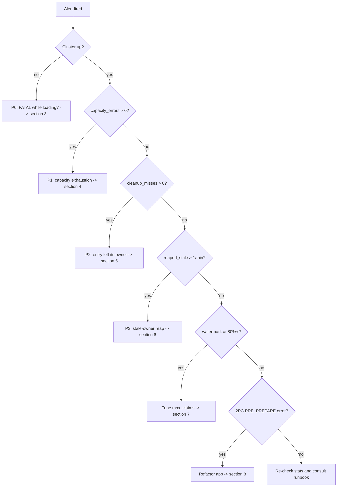
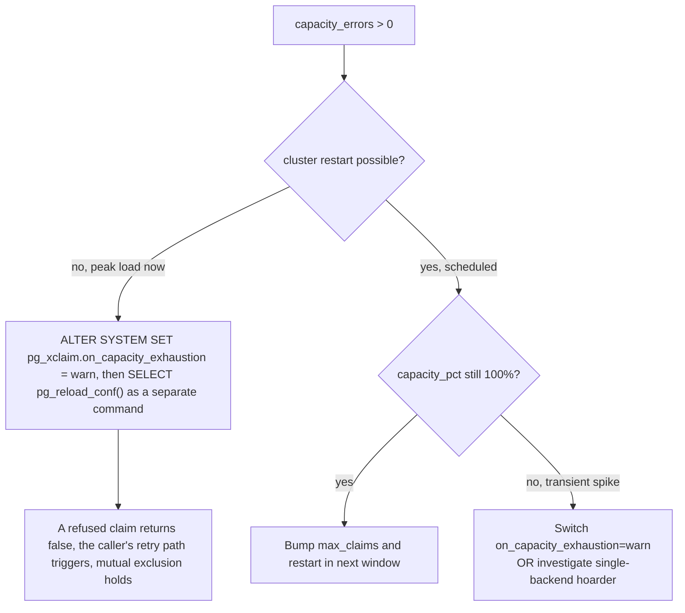

# pg_xclaim Incident Decision Tree

> **Русская версия:** [`incident-decision-tree.md`](incident-decision-tree.md).

> Convention: every command assumes `set -euo pipefail` if used in scripts.

---

## Table of Contents

1. [Severity matrix](#1-severity-matrix)
2. [Decision tree (overview)](#2-decision-tree-overview)
3. [P0 - cluster down (FATAL while loading pg_xclaim)](#3-p0---cluster-down-fatal-while-loading-pg_xclaim)
4. [P1 - capacity exhaustion (`capacity_errors > 0`)](#4-p1---capacity-exhaustion-capacity_errors--0)
5. [P2 - cleanup found its entry gone (`cleanup_misses > 0`)](#5-p2---cleanup-found-its-entry-gone-cleanup_misses--0)
6. [P3 - reaped-stale rate climbing](#6-p3---reaped-stale-rate-climbing)
7. [Watermark at 80/90/95%](#7-watermark-at-809095)
7a. [Log `crossed 75% of expected_claims_per_backend`](#7a-log-line-crossed-75-of-expected_claims_per_backend)
8. [2PC `PRE_PREPARE` reject](#8-2pc-pre_prepare-reject)
9. [Recovery (post-incident)](#9-recovery-post-incident)

---

## 1. Severity matrix

| Severity | Trigger                                       | First action |
|----------|-----------------------------------------------|--------------|
| P0       | FATAL while loading pg_xclaim post-deploy -> cluster down | Revert preload on the affected node and restart. |
| P1       | `capacity_errors` rate > 0                    | Switch `on_capacity_exhaustion` to `warn`, then raise `max_claims` in the next window. |
| P2       | `cleanup_misses` rate > 0                     | pg_xclaim defect: collect data and file an issue, do not set `enabled=off`. |
| P3       | `reaped_stale` rate > 1/min                   | Check the log for errors at transaction end and backend exit, and `cleanup_misses`. |

---

## 2. Decision tree (overview)



---

## 3. P0 - cluster down (FATAL while loading pg_xclaim)

### Symptom

Cluster fails to start. `pg_ctl start` returns non-zero. Server log
contains one of:

```
FATAL:  could not load library "/usr/lib/postgresql/16/lib/pg_xclaim.so": /usr/lib/postgresql/16/lib/pg_xclaim.so: undefined symbol: MyProcNumber
FATAL:  incompatible library "/usr/lib/postgresql/17/lib/pg_xclaim.so": version mismatch
DETAIL:  Server is version 17, library is version 16.
FATAL:  pg_xclaim.expected_claims_per_backend (N) must be <= pg_xclaim.max_claims (M)
```

The first two variants mean `pg_xclaim.so` was built for another
PostgreSQL major version, and the server refuses to load it. Which of
the two messages appears depends on the server symbols the library
lacks: a build for PG 17+ fails on PG 16 already on `MyProcNumber`.
For the last variant (GUC invariant violated) the recovery is to
lower `pg_xclaim.expected_claims_per_backend` <=
`pg_xclaim.max_claims` and start the cluster again (see
`docs/runbook_en.md` §10.6).

> **Note: hot-standby is NOT a problem.** A hot standby (or a primary still
> in WAL replay) preloads pg_xclaim cleanly. SQL calls
> (`xclaim.try`, `xclaim.try_many`, etc.) return
> `ERRCODE_FEATURE_NOT_SUPPORTED` with the message
> `pg_xclaim does not support hot-standby/recovery mode` while the
> node is in recovery -- the check fires at SQL call time, not at
> preload. Promotion to primary makes the calls succeed without any
> restart or config change once `pg_is_in_recovery() = false`.
>
> So keep `pg_xclaim` in `shared_preload_libraries` on replicas: a
> replica without it serves no claims after promotion until the config
> is changed and the server restarted.

### Investigation

1. Check `postgresql.conf` -- is `pg_xclaim` actually in
   `shared_preload_libraries`?
2. Check the running PG binary major version: `pg_config --version`.
3. Is this node a hot standby that just got promoted? `select pg_is_in_recovery();`
   (if you can connect via a fallback config).
4. `ls -la /path/to/pg_xclaim.so` -- does the `.so` exist? Is its size
   plausible (~few hundred KB)?

### Mitigation (immediate)

1. Edit `postgresql.conf` on the affected node:
   ```conf
   # shared_preload_libraries = 'citus,timescaledb,pg_xclaim'   <-- comment out
   shared_preload_libraries = 'citus,timescaledb'
   ```
2. Restart:
   ```bash
   set -euo pipefail
   pg_ctl restart -D "$PGDATA" -m fast
   ```
3. Verify cluster is up: `psql -c "SELECT 1"`.

### Post-mortem actions

- Restore a clean state: rebuild and reinstall the previous
  known-good `pg_xclaim.so`. If you do not have one yet, remove the
  binary entirely until a corrected build is available. Restart the
  cluster.

---

## 4. P1 - capacity exhaustion (`capacity_errors > 0`)

### Symptom

Application queries fail with:

```
ERROR:  pg_xclaim: max_claims (4194304) exhausted
HINT:   Increase pg_xclaim.max_claims and restart, or set
        pg_xclaim.on_capacity_exhaustion to warn.
SQLSTATE: 53400
```

`xclaim.stats().capacity_errors` rate > 0 in monitoring.

### Investigation

```sql
SELECT * FROM xclaim.stats();
```

Look for:
- `capacity_pct` close to 100
- `capacity_used` close to `capacity_max`
- `peak_per_backend` - is one backend holding most of the capacity?

```sql
-- Per-database / per-backend breakdown
SELECT database_oid, owner_pid, count(*)
FROM xclaim.debug_snapshot()
GROUP BY 1, 2
ORDER BY 3 DESC
LIMIT 20;
```

`xclaim.debug_snapshot()` holds shared locks on all partitions and is
available only when `pg_xclaim.num_partitions <= 192`. At higher
partition counts use `xclaim.stats()` and the server log.

### Mitigation -- decision branches



### Concrete commands

**Option A -- soft kill (no restart, only with user traffic stopped):**
```sql
ALTER SYSTEM SET pg_xclaim.enabled = off;
SELECT pg_reload_conf();
```
The kill switch removes mutual exclusion for every key, so with live
traffic use option B (see `docs/runbook_en.md` §4).

**Option B -- treat exhaustion as conflict (no restart):**
```sql
ALTER SYSTEM SET pg_xclaim.on_capacity_exhaustion = warn;
SELECT pg_reload_conf();
-- Acquisition returns false on exhaustion (caller's retry path
-- triggers). xclaim.try writes one WARNING per refused call.
-- xclaim.try_many writes one WARNING for the first refused slot and,
-- when several slots are refused, one summary WARNING with the number
-- of the others at the end of the call. Track capacity_warnings in
-- stats: it counts every refusal.
```

**Option C -- raise capacity (next maintenance window):**
```conf
# postgresql.conf
pg_xclaim.max_claims = 8388608   # 8M (was 4M), ~582MB shmem
```
Then `pg_ctl restart -D "$PGDATA" -m fast`.

### Post-mortem actions

- Re-baseline `expected_claims_per_backend` if a single backend held
  more than 100k claims sustained.

---

## 5. P2 - cleanup found its entry gone (`cleanup_misses > 0`)

### Symptom

`xclaim.stats().cleanup_misses` rate > 0. The counter increments when
a backend's cleanup finds its shared entry already gone or owned by
someone else, for example after the stale-owner reaper took it over.

### Investigation

1. Save `SELECT * FROM xclaim.stats();`, repeat it a minute later and
   compare `cleanup_misses`.
2. Save `xclaim.debug_snapshot()` (role `pg_monitor`) and
   `pg_stat_activity` for the same moment.
3. Pull the server log for the time of the increase: ERROR, FATAL,
   PANIC, messages of other extensions.

### Mitigation

The counter means an entry left its live owner before the owner
released it: the stale-owner reaper took over a live backend's entry,
or shared memory is corrupted. Normal operation never does this.
Mutual exclusion on those keys may have been violated: two backends
may have held the key at the same time.

1. Treat it as a pg_xclaim defect: file an issue with the data from
   the investigation.
2. Check the application data for keys processed in that window:
   double processing is possible.
3. Do not set `pg_xclaim.enabled = off`. With the extension switched
   off, `xclaim.try` returns true without claiming, and exclusion is
   gone for every key, not only the affected ones.
4. `xclaim.session_reset()`, `pg_terminate_backend()` and pool
   rotation do not help: the entry has already left its owner.
5. If the counter keeps growing, restart the server in a planned
   window. A restart creates shared memory anew.

---

## 6. P3 - reaped-stale rate climbing

### Symptom

`xclaim.stats().reaped_stale` rate > 1/min sustained.

### Investigation

```sql
SELECT * FROM xclaim.stats();
```

In parallel, inspect the server log around the increment time:
ERROR, FATAL and PANIC at transaction end and backend exit, including
those from other extensions' callbacks. Check `cleanup_misses` too.

### Mitigation

The lazy reaper itself, picking up stale entries on the next
conflict, is normal self-healing behavior. Do not try to fix it.

What the alert actually means. Each row in shared memory carries an
"owner passport": the backend slot (`procno`), its pid, the
transaction id at acquisition time (`lxid`) and `token` (a per-backend
generation counter). The reaper treats a row as stale when the slot no
longer holds that pid or the backend in the slot has published another
token: the owner exited or rotated its token, and the row stayed in
shared memory.

Normal operation leaves no such rows. Claims are released at
transaction end and at backend exit, `session_reset()` releases them
before it rotates the token, and PostgreSQL handles hard backend death
(`SIGKILL`, segfault, OOM kill) as a child crash with full
shared-memory recreation
(`REL_18_STABLE:postmaster.c:2768-2792,3180-3202`). So the alert means
that some cleanup path did not finish.

The action is one level up, not on the reaper itself:

| Cause | Fix |
|-------|-----|
| ERROR, FATAL or PANIC at transaction end or backend exit in the server log | Save those lines and `xclaim.stats()`, file an issue. |
| `cleanup_misses` grows too | See P2 (section 5). |
| Calls of `xclaim.debug_inject_stale()` | A test function that creates such rows on purpose. Remove it from non-test environments. |
| None of the above | Save `xclaim.stats()`, `xclaim.debug_snapshot()` and the log, file an issue. |

### Post-mortem actions

- If `reaped_stale` keeps growing, open an issue with the collected
  data: normal operation leaves no stale rows.

---

## 7. Watermark at 80/90/95%

### Symptom (server log)

```
LOG:  pg_xclaim: capacity watermark crossed -- 81% (3404288 / 4194304 claims)
```

Emitted when `capacity_pct` first crosses one of {80, 90, 95}. The 80%
and 90% bands are logged at `LOG` level, and the 95% band escalates to
`WARNING`. The lowest band is controlled by the
`pg_xclaim.capacity_warn_pct` GUC (default 80). Hardcoded bands
strictly below the configured `capacity_warn_pct` never fire. The
percentage in the line is an integer. A backend repeats the same band
at most once per 60 seconds and writes a climb into a higher band at
once. A check that sees the capacity below the lowest band resets this,
and the next crossing is written at once.

### Action

| Threshold | Severity | Action                                                     |
|-----------|----------|------------------------------------------------------------|
| 80%       | warn     | Plan a `max_claims` bump in the next maintenance window.   |
| 90%       | page     | Page oncall and consider switching to `warn` mode (treat exhaustion as conflict). |
| 95%       | page     | Find the transactions that hold claims (`xclaim.debug_snapshot()` by `owner_pid`, `pg_stat_activity`). If not done at 90%, switch to `on_capacity_exhaustion = warn` (treat exhaustion as conflict). Plan a `max_claims` raise with a restart. Do not set `pg_xclaim.enabled = off` on live traffic (§4). |

```sql
-- Inspect what's filling capacity:
SELECT database_oid, count(*) AS claims_held
FROM xclaim.debug_snapshot()
GROUP BY 1
ORDER BY 2 DESC;
```

`xclaim.debug_snapshot()` requires `pg_xclaim.num_partitions <= 192`.

---

## 7a. Log line "crossed 75% of expected_claims_per_backend"

### Symptom (server log)

```
LOG:  pg_xclaim: per-backend live claims (12345) crossed 75% of
      pg_xclaim.expected_claims_per_backend (16384) -- simplehash
      will rehash on further growth
HINT:  Raise pg_xclaim.expected_claims_per_backend to your observed
       peak and restart the cluster.
```

### What it means

A backend has, for the first time in its session, accumulated 75% of
`expected_claims_per_backend`. This is an early-warning signal: the
growth by the fill threshold happens when the backend-local
`simplehash` bucket-array fill reaches 0.9 (fillfactor), and the 75%
mark leaves headroom to raise the GUC before a rehash lands on the
acquire hot path. The set grows earlier on a long probe, and
`xclaim.try_many` writes this line after its loop, so a growth can come
before it (`docs/runbook_en.md` §3).

This is not an error and not a page-worthy event. The extension
keeps working correctly, it just pays rehash latency on the next
acquires. The line is emitted once per session (and again after
`xclaim.session_reset()` if the backend crosses the threshold once
more).

### Action

1. Read the actual peak: `SELECT peak_per_backend FROM xclaim.stats();`
2. Raise the GUC to the peak with a 1.2x-1.5x margin:
   ```conf
   pg_xclaim.expected_claims_per_backend = 32768   # example: peak ~22k
   ```
3. Restart the cluster (PGC_POSTMASTER).

---

## 8. 2PC `PRE_PREPARE` reject

### Symptom

```
ERROR:  pg_xclaim: PREPARE TRANSACTION is not allowed while pg_xclaim claims are held
HINT:   Release pg_xclaim claims (or COMMIT/ROLLBACK the transaction) before preparing.
SQLSTATE: 0A000  -- feature_not_supported
```

### Cause

pg_xclaim explicitly rejects 2PC handoff on `XACT_EVENT_PRE_PREPARE`.
This is a hard limitation of the extension - PostgreSQL's own
advisory locks behave differently: they are persisted across
`PREPARE TRANSACTION` via `AtPrepare_Locks()` (see PG18
`lock.c:3446`, PG17 `lock.c:3304`, PG16 `lock.c:3299`), and a later
`COMMIT/ROLLBACK PREPARED` releases them. pg_xclaim does
not implement that path because PostgreSQL has no public API for an
extension to register itself as a 2PC participant - the internal
`RegisterTwoPhaseRecord` API uses a fixed `TwoPhaseRmgrId` (a `uint8`
typedef in `twophase_rmgr.h`) whose resource-manager IDs are a closed set
of built-in `#define` constants (capped by `TWOPHASE_RM_MAX_ID`) that
extensions cannot extend.

### Mitigation

There is no DBA-side fix here. Three options for the application:

1. Move the lock-acquiring step out of the prepared transaction.
2. Use `pg_try_advisory_xact_lock` directly on that path.
3. Restructure the workflow so 2PC is not needed at all.

---

## 9. Recovery (post-incident)

After any P0/P1/P2 incident:

1. Confirm `xclaim.stats()` clean:
   ```sql
   SELECT * FROM xclaim.stats();
   -- expected: capacity_errors and cleanup_misses do not grow over the
   --           check window (the counters are cumulative, only a restart
   --           resets them), reaped_stale rate stable
   ```
2. Re-enable acquisition if disabled:
   ```sql
   ALTER SYSTEM SET pg_xclaim.enabled = on;
   SELECT pg_reload_conf();
   ```
3. Verify wait-event distribution returned to baseline:
   ```sql
   SELECT wait_event_type, wait_event, count(*)
   FROM pg_stat_activity
   WHERE state IS NOT NULL
   GROUP BY 1, 2
   ORDER BY 3 DESC;
   ```
